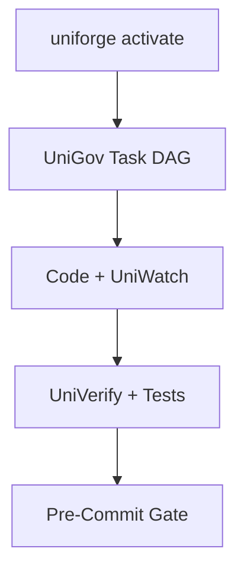

<div align="center">

```text
  _    _       _ ______
 | |  | |     (_)  ____|
 | |  | |_ __  _| |__ ___  _ __ __ _  ___
 | |  | | '_ \| |  __/ _ \| '__/ _` |/ _ \
 | |__| | | | | | | | (_) | | | (_| |  __/
  \____/|_| |_|_|_|  \___/|_|  \__, |\___|
                                __/ |
                               |___/
```

### **Sovereign Autonomous Developer Suite & Engineering Machine**

[-8b5cf6?style=for-the-badge)]()
[]()
[]()
[]()

*Consolidating 7 Sovereign Developer Services, the Sovereign Coding Triad, and the Frontal Lobe Deliberative Engine into one unified CLI and monorepo.*

</div>

---

## How UniForge Works



```text
+-----------------------------------------------------------------------------+
|                           UNIFORGE MASTER CLI                               |
|        uniforge activate | doctor | status | init | test | version          |
+-----------------------------------------------------------------------------+
       |                    |                    |                    |
       v                    v                    v                    v
+--------------+    +---------------+    +---------------+    +---------------+
|   UNIGOV     |    |   UNISKILL    |    |   UNIMEMORY   |    |   UNIVERIFY   |
| Task DAG &   |    | Skill Router  |    | 5-Tier Living |    | Z3 SMT Proofs |
| 5 Organs 2.0 |    | Token Saver   |    | HippoRAG 2 DB |    | Law-000 Guard |
+--------------+    +---------------+    +---------------+    +---------------+
       |                    |                    |                    |
       v                    v                    v                    v
+--------------+    +---------------+    +---------------+    +---------------+
|   UNIEXEC    |    |    UNIBUS     |    |   UNIWATCH    |    |     TRIAD     |
| Bubblewrap   |    | UDS IPC &     |    | Inotify AST   |    | Python/Kotlin |
| Sandbox Run  |    | File Mutexes  |    | Sentinel      |    | Security Team |
+--------------+    +---------------+    +---------------+    +---------------+
                                    |
                                    v
                     +-----------------------------+
                     |    DELIBERATION ENGINE      |
                     | 5 Councils + MCTS Planner   |
                     +-----------------------------+
```

---

## The 9 Sovereign Pillars

| Pillar | Package | Command | Core Capability |
| :--- | :--- | :--- | :--- |
| **1. Governance** | `packages/unigov` | `unigov` | Task DAG, 15-Dim Vision/Plan Sync, Error Telemetry, AST Cache & Drift Gate (`75` commands) |
| **2. Skills** | `packages/uniskill` | `uniskill` | Surgical Skill Router & Zero-Noise Token Economizer (`212/212` SHA-256 parity) |
| **3. Memory** | `packages/unimemory` | `unimemory` | 5-Tier Living Memory Substrate (`brain_memory.db`) & HippoRAG 2 |
| **4. Verification** | `packages/univerify` | `univerify` | 4-Tier Gatekeeper (Z3 SMT Solver, Law-000 Guard, Touch Bounds) |
| **5. Execution** | `packages/uniexec` | `uniexec` | Linux Bubblewrap (`bwrap`) Sandboxed Code-Mode Micro-Runtime |
| **6. IPC Bus** | `packages/unibus` | `unibus` | Real-Time Unix Domain Socket IPC & File Work Mutex Bus |
| **7. Watchdog** | `packages/uniwatch` | `uniwatch` | Linux Inotify Continuous Sentinel & Balanced AST Watchdog |
| **8. Coding Triad** | `packages/sovereign_triad` | `triad` | Python + Kotlin + Security AppSec Specialist Council |
| **9. Deliberation** | `packages/deliberation` | `deliberate` | Frontal Lobe Deliberative Councils (5) & MCTS Code Planner |

---

## UniGov v1.1.0 Key Capabilities

- **15-Dimension `PROJECT_VISION_AND_PLAN/` Live Sync (`vision_plan_sync.py`)**: Automatically mirrors `.unigov/state.db` (`project_vision`, `tasks`, `ingested_docs`) into `00_MASTER_ROADMAP.md` and 15 architectural dimension folders (`01_VISION_AND_CONSTRAINTS/` through `15_SELF_HEALING_AND_RESILIENCE/`).
- **Smart & Offline-Capable Doc Ingest (`ingest.py`)**: Anti-loop guard (ignores generated `PROJECT_VISION_AND_PLAN/`), incremental changed-file prompting, deterministic offline Markdown fallback parser, anti-zombie `PENDING` task cleanup, and `t.layer` preservation.
- **Parent Milestone Auto-Rollup (`executor.py`)**: Completing all child tasks automatically rolls up parent `MODULE` and `MILESTONE` nodes to `COMPLETED`.
- **Incremental SHA-256 AST Cache (`ast_graph.py`)**: `.unigov/ast_cache.db` caches per-file symbol graphs with SHA-256 invalidation and deletion pruning (`2.490s` cold scan -> `0.118s` warm scan on `UniForge`).
- **Universal Error Telemetry & Share Engine (`error_telemetry.py`, `INV-OBS-001`)**:
  - Automatic PII/secret scrubbing (`scrub_pii`), 20-step action breadcrumbs, and innermost-frame SHA-256 fingerprinting.
  - `OPEN -> FIXED -> REGRESSION` lifecycle tracking in `.unigov/error_logs/events.db` + crash-safe `queue/*.json`.
  - 1-command shareable redacted `.zip` diagnostic export (`unigov bug-bundle`) and optional Firebase Firestore REST sync (`unigov errors --sync`).
- **Drift & Self-Audit (`unigov drift`, `unigov audit-self`)**: Staged/unstaged drift & secret scanning plus `100/100` self-audit health verification.

---

## UniGov 2.0: The 5 Autonomous Cognitive Organs

1. **`unigov cartography`** (`cartography.py`) — Polyglot stack detection (Android Compose, Next.js 15, Rust, Python) & Clean Architecture layer classification (`DOMAIN`, `DATA`, `PRESENTATION`, `INFRASTRUCTURE`).
2. **`unigov screen-intel`** (`screen_intel.py`) — Compose & TSX spatial layout tree extractor verifying 48x48dp touch targets, system bar insets, and scroll containers.
3. **`unigov vision-eval`** (`vision_anchor.py`) — Offline-first local DB fallback audit, Law ACC-001 integer-paise financial check, and UI readability verification.
4. **`unigov auto-deliberate`** (`auto_deliberation.py`) — Context-aware blast-radius & domain sensitivity risk scorer (`FINANCIAL`, `AUTH`, `SAFETY`, `DATABASE_SCHEMA`) with autonomous Red Team critique triggers.
5. **`unigov learn-reflex`** (`reflexive_learner.py`) — Failure pattern clustering & candidate invariant synthesis queued to `UniEvolve` (`PENDING_APPROVAL`).

---

## Quick Start & Master CLI

```bash
# Instant workspace bootstrap (introspects project & activates governance)
uniforge activate

# Run holistic 15-pillar system diagnostics
uniforge doctor

# Run all 9 monorepo test suites (234 tests)
uniforge test

# View active workspace governance, constraints & DAG status
uniforge status [path]

# Ingest planning markdown docs & sync PROJECT_VISION_AND_PLAN/
unigov ingest ./docs --auto-approve

# Run deterministic drift & security check
unigov drift --skip-llm --unstaged

# View captured error telemetry / sync to Firebase / export shareable .zip bundle
unigov errors [--sync] [--resolve <fingerprint>]
unigov bug-bundle

# Run UniGov holistic self-audit (100/100)
unigov audit-self
```

---

## Repository Layout

```text
UniForge/
├── bin/                   # Global CLI wrappers & symlinks
├── src/uniforge/          # Master CLI, activator, planner & workspace router
├── packages/
│   ├── unigov/            # Sovereign Governance Engine, 5 Organs, Vision/Plan Sync & Error Telemetry
│   ├── uniskill/          # Surgical Skill Router & Economizer
│   ├── unimemory/         # 5-Tier Memory & HippoRAG 2 Graph
│   ├── univerify/         # Z3 SMT & Law-000 Gatekeeper
│   ├── uniexec/           # Bubblewrap Sandboxed Execution
│   ├── unibus/            # UDS IPC & Work Mutex Bus
│   ├── uniwatch/          # Inotify AST Sentinel
│   ├── sovereign_triad/   # 3-Specialist Coding Triad
│   └── deliberation/      # 5 Councils + MCTS Planner
├── PLANNING/              # Architectural plans, GSIE reviews & cognitive brain state
├── pyproject.toml         # Package configuration
└── Makefile               # Build & test targets
```

---

<div align="center">
  <sub>Architected by <strong>Founder Shoeb Ahmad</strong> &amp; <strong>Antigravity (UniAi)</strong></sub>
</div>
